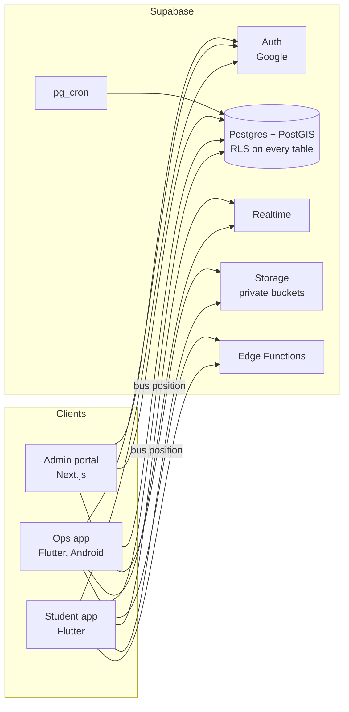

# BusIn architecture

Status: design for the rebuild. Decisions are recorded in [docs/decisions/](docs/decisions/). Progress is tracked in [STATUS.md](STATUS.md).

## Tiers



Each audience gets its own app so a client only contains, and only requests, what its user needs.

| Tier | Users | Loads |
|---|---|---|
| Student app | Students | Own profile, own subscriptions, own scans, stops, live position of the bus they ride |
| Ops app | Staff, drivers | Today's trip, cached list of valid riders for that trip, scan queue |
| Admin portal | School admins | Paginated people, subscriptions, scans, aggregates for their school |

## Backend

One Supabase project per environment (`dev` local, `prod` hosted). Everything is multi-tenant: every tenant-owned table carries `school_id`.

### Core tables (names indicative, finalised in Phase 1)

| Table | Purpose |
|---|---|
| `schools` | Name, timezone, allowed email domains, settings |
| `profiles` | One row per auth user: school, role (`student`, `staff`, `admin`), status |
| `semesters` | Per school, with exact start and end dates |
| `stops` | Per school, PostGIS point, photo path |
| `buses`, `trips` | Plate, capacity and an in-service flag (at least 2 buses, sometimes 1 operating); a trip is one bus run with direction, driver, start and end |
| `subscriptions` | Student, semester, stop, status, proof file path, review note |
| `scans` | Student, trip, stop (scans happen at each stop at boarding), scanner, time, location. Unique on trip + student so a repeat scan is idempotent |
| `live_positions` | Latest position per bus (one row, overwritten) |
| `audit_log` | Who approved, rejected, promoted or suspended whom |
| `stats_*` | Nightly aggregates written by `pg_cron` for the portal |

### Authentication and authorization

- Google sign-in through `signInWithIdToken` on mobile and the OAuth redirect flow on web.
- A database check on sign-up matches the email domain against `schools.allowed_domains`. Unknown domains are rejected.
- Sign-up always creates a `student`. Staff and admin roles are granted only through RPC functions callable by an admin, which write the audit log.
- A custom access token hook adds `school_id`, `role` and `status` to the token for client routing. Row Level Security reads the same values live from `profiles` through helper functions, so a suspension applies immediately (see [ADR 0005](docs/decisions/0005-rls-reads-live-profile.md)). Users cannot write them.
- Privileged work (approve, reject, promote, suspend, QR secret issue) runs in `security definer` database functions or Edge Functions, never as direct client writes.

### Storage

Private buckets only: payment proofs (`proofs/{school_id}/{user_id}/...`) and stop photos. Clients upload to their own path and read through short-lived signed URLs. Storage policies mirror the RLS rules.

### Rotating QR code

Each student has a per-student secret held server-side. The student app fetches it once and derives a code from `HMAC(secret, student_id : 30-second window)`. Staff submit the scanned code to `record_qr_scan`, which verifies it in the database. A photographed code expires within about a minute. See [ADR 0006](docs/decisions/0006-rotating-qr-design.md) for the limits and [the format](docs/guides/qr-code-format.md).

### Live bus tracking

One `live_positions` row per bus, updated every 10 to 15 seconds by the source (driver mode in the ops app, later a hardware tracker through an ingest endpoint). Students subscribe to a Realtime channel filtered to their bus. A thinned history (about one point every 30 seconds) is kept per trip for ETA learning.

### Analytics pipeline

`pg_cron` aggregates scans nightly into small `stats_*` tables (boardings per stop per 30-minute slot, per geohash cell, per trip). The portal reads aggregates, not raw scans. Pickup suggestions use PostGIS clustering. Route optimization runs in a separate solver service (Phase 5). AI summaries, if used, receive aggregates only, never personal data.

## Least-data rules

- Select named columns. Paginate every list. Filter Realtime to the rows the screen shows.
- Admin code and admin queries exist only in the admin portal.
- Controllers and subscriptions start after sign-in and stop on sign-out.
- Location permission is requested only in the ops app, only when scanning or driving.

## Client structure

```
apps/student, apps/ops  ->  packages/busin_data  ->  packages/busin_core
        |                                                 ^
        +--------------- packages/busin_ui ---------------+ (UI only, no data access)
```

`busin_core` has no Flutter and no Supabase imports. `busin_data` is the only package that talks to Supabase from Dart. The admin portal talks to Supabase from TypeScript with the server-side client for privileged reads.

## Configuration and secrets

Clients receive only public values (Supabase URL, publishable key) through `--dart-define-from-file` or Next.js public env vars. Nothing secret is shipped. Service keys and third-party API keys exist only in Supabase function secrets or the portal's server environment. App Check style abuse protection is replaced by RLS, rate limits on Edge Functions, and Play Integrity attestation where needed.

## Pinned versions

| Tool | Version | Notes |
|---|---|---|
| Flutter | 3.47.9 (Dart 3.13.7) | `.fvmrc`. Flutter has no LTS line; upgrades happen in dedicated PRs, never inside a feature PR |
| Node | 24 LTS | `.nvmrc`, `engines` |
| Next.js / React / TypeScript | 16.x / 19.x / latest 5.x or 7.x stable at Phase 2 start | Verified when the portal is created |
| Supabase CLI | 2.122.0 | Dev dependency, run with `npx supabase` |
| Postgres | CLI default (17) | Extensions: PostGIS, pg_cron, pgTAP |
| Java | 21 LTS | Android Gradle builds |
| `apps/legacy` | Flutter 3.35.6 | Frozen, own pin |

## Out of scope for now

Mobile Money payments, hardware tracker ingest, route solver and multi-school onboarding UI are planned in [Phase 5 and 6](docs/phases/).
